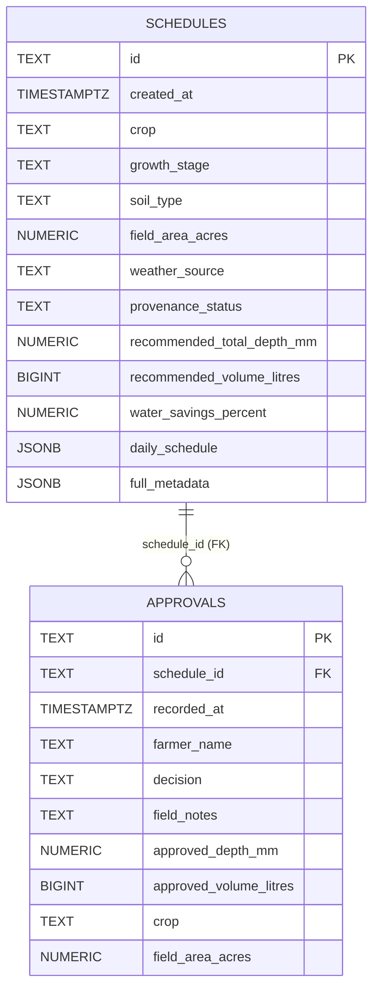
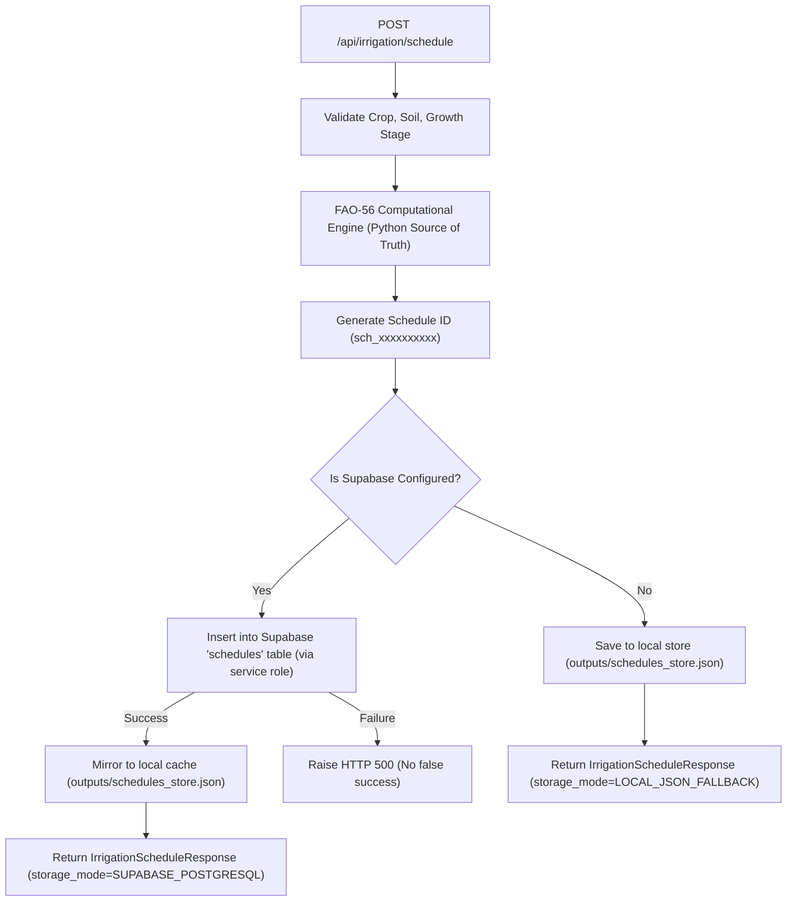
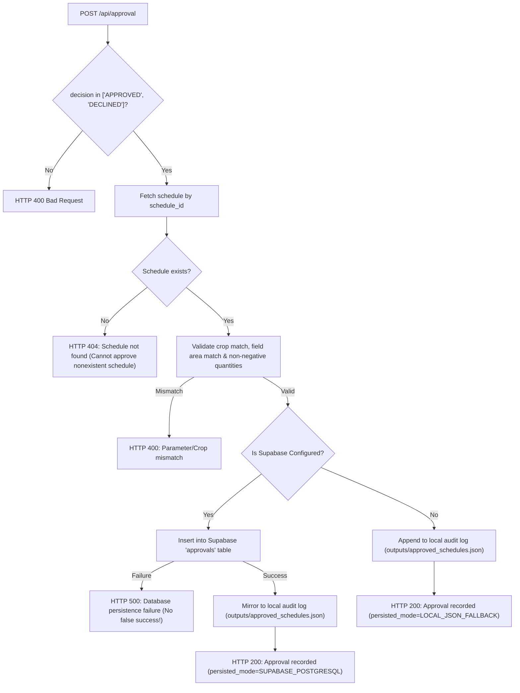

# AGRI-2 – Phase 4: Supabase PostgreSQL Integration Report

**Project**: AGRI-2 – Irrigation Scheduling Advisor  
**Phase**: Phase 4 – Supabase PostgreSQL Integration  
**Date**: November 2026  
**Status**: Completed  
**Automated Tests**: 57 Passed (44 Existing + 13 Supabase Integration Tests)

---

## 1. Files Created and Modified

### Created Files
| File Path | Description |
| :--- | :--- |
| `supabase/migrations/20261124000000_create_schedules_and_approvals.sql` | SQL migration script creating `schedules` and `approvals` tables, indexes, constraints, and Row Level Security (RLS) policies. |
| `supabase/schema.sql` | Idempotent schema reference for direct execution in Supabase Dashboard SQL Editor or CLI. |
| `src/db_client.py` | Supabase PostgreSQL client module providing resilient database CRUD operations, safe credential management, error containment, and offline storage fallbacks. |
| `tests/test_supabase_integration.py` | Automated unit and integration test suite mocking Supabase to test insertion, retrieval, offline fallbacks, failure recovery, and verification checks. |
| `docs/PHASE_4_SUPABASE_REPORT.md` | Comprehensive Phase 4 engineering and migration report. |

### Modified Files
| File Path | Description |
| :--- | :--- |
| `config/settings.py` | Centralized `SUPABASE_URL` and `SUPABASE_SERVICE_ROLE_KEY` loading from environment variables. |
| `.env.example` | Added configuration placeholders for `SUPABASE_URL` and `SUPABASE_SERVICE_ROLE_KEY`. |
| `.env` | Local development environment populated with placeholders for safe offline development. |
| `requirements.txt` | Added `supabase>=2.3.0` dependency. |
| `src/approval_logger.py` | Integrated Supabase persistent write for approvals when configured, preserved resilient local JSON fallback, and eliminated false success reports on write failures. |
| `api/schemas/approval.py` | Added `ApprovalHistoryItem` and `ApprovalHistoryResponse` schemas. |
| `api/schemas/irrigation.py` | Added `ScheduleHistorySummary` and `ScheduleHistoryResponse` schemas. |
| `api/routes/approval.py` | Added schedule verification checks (existence, crop match, field area match, volume/depth validation) before recording approvals; added `GET /api/approval/history` endpoint with safe limits. |
| `api/routes/irrigation.py` | Persists calculated schedules to Supabase when configured (or local fallback); added `GET /api/irrigation/history` endpoint with safe limits. |

---

## 2. Database Schema and SQL Migration Location

### Migration Location
- Primary migration file: `supabase/migrations/20261124000000_create_schedules_and_approvals.sql`
- Direct SQL schema copy: `supabase/schema.sql`

### Database Entities and Relationships



### Table Definitions & Constraints
1. **`schedules`**:
   - `id` (TEXT, Primary Key): e.g., `sch_a1b2c3d4e5`
   - `created_at` (TIMESTAMPTZ, Default `now()` UTC)
   - `crop` (TEXT, Not Null)
   - `growth_stage` (TEXT, Not Null)
   - `soil_type` (TEXT, Not Null)
   - `field_area_acres` (NUMERIC, Not Null, `CHECK (field_area_acres > 0)`)
   - `weather_source` (TEXT, Not Null)
   - `provenance_status` (TEXT, Not Null)
   - `recommended_total_depth_mm` (NUMERIC, Not Null, `CHECK (recommended_total_depth_mm >= 0)`)
   - `recommended_volume_litres` (BIGINT, Not Null, `CHECK (recommended_volume_litres >= 0)`)
   - `water_savings_percent` (NUMERIC, Not Null)
   - `daily_schedule` (JSONB, Not Null, Default `'[]'::jsonb`)
   - `full_metadata` (JSONB, Not Null, Default `'{}'::jsonb`)

2. **`approvals`**:
   - `id` (TEXT, Primary Key): e.g., `appr_f9e8d7c6`
   - `schedule_id` (TEXT, Foreign Key referencing `schedules(id)` `ON DELETE RESTRICT`)
   - `recorded_at` (TIMESTAMPTZ, Default `now()` UTC)
   - `farmer_name` (TEXT, Not Null)
   - `decision` (TEXT, Not Null, `CHECK (decision IN ('APPROVED', 'DECLINED'))`)
   - `field_notes` (TEXT, Default `''`)
   - `approved_depth_mm` (NUMERIC, Not Null, `CHECK (approved_depth_mm >= 0)`)
   - `approved_volume_litres` (BIGINT, Not Null, `CHECK (approved_volume_litres >= 0)`)
   - `crop` (TEXT, Not Null)
   - `field_area_acres` (NUMERIC, Not Null, `CHECK (field_area_acres > 0)`)

3. **Performance Indexes**:
   - `idx_schedules_created_at ON schedules (created_at DESC)`
   - `idx_schedules_crop ON schedules (crop)`
   - `idx_approvals_schedule_id ON approvals (schedule_id)`
   - `idx_approvals_recorded_at ON approvals (recorded_at DESC)`
   - `idx_approvals_farmer_name ON approvals (farmer_name)`

---

## 3. Environment Variable Configuration

The backend reads configuration directly from environment variables:

```bash
# Supabase PostgreSQL Database Configuration
SUPABASE_URL=https://your-project-id.supabase.co
SUPABASE_SERVICE_ROLE_KEY=your_supabase_service_role_secret_key
```

### Security Rules:
- Actual credentials are never committed to Git, frontend bundles, or client-side code.
- `.env.example` provides sanitized variable placeholders.
- When `SUPABASE_URL` or `SUPABASE_SERVICE_ROLE_KEY` is omitted or empty, the application safely operates in **offline development mode** using local JSON storage fallbacks.

---

## 4. RLS Policies and Security Limitations

### Row Level Security (RLS) Implementation
- Row Level Security is explicitly enabled on both tables:
  ```sql
  ALTER TABLE public.schedules ENABLE ROW LEVEL SECURITY;
  ALTER TABLE public.approvals ENABLE ROW LEVEL SECURITY;
  REVOKE ALL ON public.schedules FROM anon;
  REVOKE ALL ON public.approvals FROM anon;
  ```
- Public (`anon`) access is completely revoked. Public users cannot read, insert, update, or delete any rows directly from client applications.
- All database operations are mediated strictly by the **FastAPI backend** running server-side with the `SUPABASE_SERVICE_ROLE_KEY`, which safely bypasses RLS for verified backend requests.

### Security Limitations and Documented Constraints
> [!WARNING] Multi-Farmer Authentication Limitation
> Farmer authentication (JWT / OAuth / user identity) is not yet integrated into the system. As a result, the database does not currently enforce multi-tenant isolation per individual farmer at the database layer. 
>
> All reads and writes are managed through server-side application endpoints. Consequently, the database is **not claimed to be production-secure for multi-tenant isolation** until farmer identity tokens (e.g. Supabase Auth JWT) are passed and validated in subsequent phases.

---

## 5. Schedule Persistence Workflow



---

## 6. Farmer Approval Workflow



---

## 7. API Endpoints Reference

| Method | Endpoint | Description | Query / Body Parameters | Response |
| :--- | :--- | :--- | :--- | :--- |
| `POST` | `/api/irrigation/schedule` | Generates 7-day schedule and persists to Supabase. | `IrrigationScheduleRequest` | `IrrigationScheduleResponse` |
| `GET` | `/api/irrigation/history` | Retrieves recent schedule history (restricted). | `limit` (int, default 20, max 100), `crop` (optional) | `ScheduleHistoryResponse` |
| `POST` | `/api/approval` | Validates schedule and records farmer approval/decline. | `ApprovalRequest` | `ApprovalResponse` |
| `GET` | `/api/approval/history` | Retrieves recent farmer approval history (restricted). | `limit` (int, default 20, max 100), `schedule_id` (optional), `farmer_name` (optional) | `ApprovalHistoryResponse` |

---

## 8. Test Execution Results

All automated tests passed successfully using pytest with full mocking:

```text
============================= test session starts =============================
platform win32 -- Python 3.11.0, pytest-9.2.0, pluggy-1.7.0
rootdir: C:\Users\rethu\Downloads\Industry solution
collected 57 items

tests/test_api_routes.py::test_health_endpoint PASSED                    [  1%]
tests/test_api_routes.py::test_weather_forecast_endpoint_mocked PASSED   [  3%]
tests/test_api_routes.py::test_weather_forecast_invalid_coordinates PASSED [  5%]
tests/test_api_routes.py::test_weather_forecast_api_failure PASSED       [  7%]
tests/test_api_routes.py::test_weather_historical_endpoint_mocked PASSED [  8%]
tests/test_api_routes.py::test_weather_historical_invalid_date_range PASSED [ 10%]
tests/test_api_routes.py::test_weather_historical_api_failure PASSED     [ 12%]
tests/test_api_routes.py::test_irrigation_schedule_valid_scenario PASSED [ 14%]
tests/test_api_routes.py::test_irrigation_schedule_invalid_crop PASSED   [ 15%]
tests/test_api_routes.py::test_irrigation_schedule_invalid_soil PASSED   [ 17%]
tests/test_api_routes.py::test_irrigation_schedule_custom_weather_records PASSED [ 19%]
tests/test_api_routes.py::test_advisory_endpoint_deterministic_fallback PASSED [ 21%]
tests/test_api_routes.py::test_advisory_endpoint_telugu_language PASSED  [ 22%]
tests/test_api_routes.py::test_advisory_endpoint_invalid_language_rejected PASSED [ 24%]
tests/test_api_routes.py::test_approval_endpoint_valid PASSED            [ 26%]
tests/test_api_routes.py::test_approval_endpoint_invalid_decision PASSED [ 28%]
tests/test_crop_coefficients.py::test_rice_kc_stages PASSED              [ 29%]
tests/test_crop_coefficients.py::test_kc_climatic_adjustment PASSED      [ 31%]
tests/test_crop_coefficients.py::test_calculate_etc PASSED               [ 33%]
tests/test_data_collection.py::test_openmeteo_forecast_parsing_and_units PASSED [ 35%]
tests/test_data_collection.py::test_openmeteo_missing_weather_values_imputation PASSED [ 36%]
tests/test_data_collection.py::test_openmeteo_api_connection_failure PASSED [ 38%]
tests/test_data_collection.py::test_nasa_power_historical_retrieval_and_standardization PASSED [ 40%]
tests/test_data_collection.py::test_soilgrids_response_parsing_and_units PASSED [ 42%]
tests/test_data_collection.py::test_soilgrids_timeout_fallback PASSED    [ 43%]
tests/test_data_collection.py::test_tnau_rice_guidelines_loading PASSED  [ 45%]
tests/test_data_collection.py::test_live_weather_fed_to_irrigation_engine PASSED [ 47%]
tests/test_eto.py::test_fao56_worked_example_18_uccle PASSED             [ 49%]
tests/test_eto.py::test_wind_speed_adjustment_10m_to_2m PASSED           [ 50%]
tests/test_eto.py::test_coimbatore_tropical_eto_bounds PASSED            [ 52%]
tests/test_nexus.py::test_missing_api_key_handling PASSED                [ 54%]
tests/test_nexus.py::test_whitespace_api_key_handling PASSED             [ 56%]
tests/test_nexus.py::test_valid_api_key_configuration PASSED             [ 57%]
tests/test_nexus.py::test_fallback_advisory_bilingual PASSED             [ 59%]
tests/test_nexus.py::test_advisory_generator_resilience PASSED           [ 61%]
tests/test_nexus.py::test_advisory_generator_empty_content_fallback PASSED [ 63%]
tests/test_rainfall.py::test_usda_scs_effective_rainfall PASSED          [ 64%]
tests/test_rainfall.py::test_paddy_bund_effective_rainfall PASSED        [ 66%]
tests/test_rainfall.py::test_calculate_effective_rainfall_dispatcher PASSED [ 68%]
tests/test_scheduler.py::test_volume_conversion PASSED                   [ 70%]
tests/test_scheduler.py::test_7day_schedule_generation_and_performance PASSED [ 71%]
tests/test_supabase_integration.py::test_missing_supabase_configuration PASSED [ 73%]
tests/test_supabase_integration.py::test_local_offline_fallback PASSED   [ 75%]
tests/test_supabase_integration.py::test_successful_schedule_insertion_mocked PASSED [ 77%]
tests/test_supabase_integration.py::test_successful_approval_insertion_mocked PASSED [ 78%]
tests/test_supabase_integration.py::test_database_connection_failure PASSED [ 80%]
tests/test_supabase_integration.py::test_no_false_success_response_when_persistence_fails PASSED [ 82%]
tests/test_supabase_integration.py::test_invalid_schedule_id PASSED      [ 84%]
tests/test_supabase_integration.py::test_approval_for_nonexistent_schedule PASSED [ 85%]
tests/test_supabase_integration.py::test_approval_crop_mismatch_rejected PASSED [ 87%]
tests/test_supabase_integration.py::test_approval_field_area_mismatch_rejected PASSED [ 89%]
tests/test_supabase_integration.py::test_invalid_approval_decision PASSED [ 91%]
tests/test_supabase_integration.py::test_database_retrieval_schedules PASSED [ 92%]
tests/test_supabase_integration.py::test_database_retrieval_approvals PASSED [ 94%]
tests/test_water_balance.py::test_water_balance_no_rainfall PASSED       [ 96%]
tests/test_water_balance.py::test_water_balance_heavy_rainfall PASSED    [ 98%]
tests/test_water_balance.py::test_low_vs_adequate_initial_moisture PASSED [100%]

======================= 57 passed, 2 warnings in 12.35s =======================
```

---

## 9. Steps to Connect the Live Supabase Project

To connect this application to a real Supabase PostgreSQL project:

1. **Create or Open a Supabase Project**:
   - Go to [Supabase Dashboard](https://supabase.com/dashboard).
   - Create a new project (e.g. `agri2-irrigation-advisor`) in your preferred region.

2. **Execute Database Migrations**:
   - Open the **SQL Editor** tab in your Supabase Dashboard.
   - Open `supabase/schema.sql` (or `supabase/migrations/20261124000000_create_schedules_and_approvals.sql`).
   - Paste the SQL script and click **Run**.
   - Verify in the **Table Editor** that `schedules` and `approvals` tables and indexes are created with RLS enabled.

3. **Obtain Server API Keys**:
   - Navigate to **Project Settings** > **API**.
   - Copy the **Project URL** (`https://<project-ref>.supabase.co`).
   - Copy the **`service_role` secret key** (revealed under Project API Keys).
   - *Important*: Keep the `service_role` secret key secure. Never expose it to the client frontend.

4. **Configure Environment Variables**:
   - Update your server environment (or local `.env` file):
     ```bash
     SUPABASE_URL=https://<project-ref>.supabase.co
     SUPABASE_SERVICE_ROLE_KEY=eyJhbGciOi...<service_role_secret_key>
     ```

5. **Start or Restart FastAPI Server**:
   - Run `uvicorn api.index:app --reload`
   - Generated schedules and farmer decisions will now automatically persist to Supabase PostgreSQL, with automatic fallback protection if the network disconnects.
