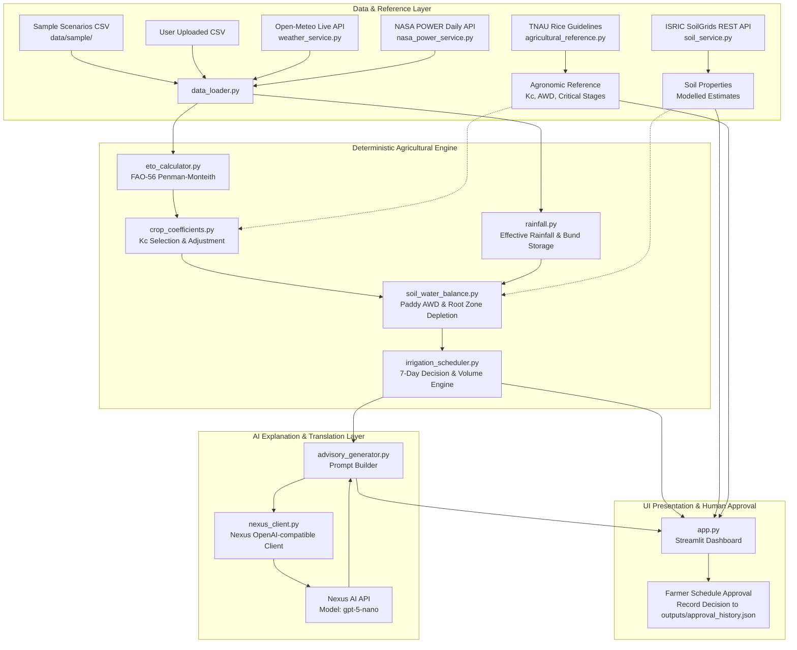

# System Architecture: AGRI-2 Irrigation Scheduling Advisor

## 1. System Philosophy and Design Principles
The core architecture of AGRI-2 is founded on the principle of **computational sovereignty**:
1. **Mathematical Single Source of Truth**: All physical, agronomic, and hydrological calculations (Reference Evapotranspiration, Crop Coefficients, Effective Rainfall, and Soil Water Balance) are strictly computed by deterministic Python engines adhering to FAO-56 standards.
2. **LLM Boundary Protection**: The Large Language Model (Nexus API / GPT-5-nano) **never** calculates, infers, or alters any numerical values. Its role is strictly confined to farmer-facing qualitative explanation, rationale summarization, and multilingual translation (English & Tamil).
3. **Manual Farmer In-the-Loop Control**: In strict compliance with agricultural safety guidelines, all valve operations remain strictly manual. The application requires explicit human farmer approval before recording a schedule.

---

## 2. Architectural Block Diagram

---

## 3. Directory and Module Organization
- `config/settings.py`: Stores soil physical properties, crop stage parameters, geographical constants, and Nexus credentials.
- `src/eto_calculator.py`: FAO-56 Penman-Monteith reference evapotranspiration calculation.
- `src/crop_coefficients.py`: Stage-specific crop coefficient selection and aerodynamic corrections.
- `src/rainfall.py`: USDA-SCS effective precipitation model and rice bund retention simulation.
- `src/soil_water_balance.py`: Dual-mode simulation: Wetland Rice (Ponded & AWD) and Upland Crop (Root Zone Depletion).
- `src/irrigation_scheduler.py`: 7-day schedule synthesis, water volume calculation (Litres), baseline comparison (15%+ water saving).
- `src/weather_service.py`: Open-Meteo live 7-day forecast retrieval with 10m-to-2m wind conversion and unit standardizations.
- `src/nasa_power_service.py`: NASA POWER daily API client, raw caching, and standardized historical agro-climatology processing.
- `src/soil_service.py`: ISRIC SoilGrids REST client for modelled soil property estimates with regional baseline fallback.
- `src/agricultural_reference.py`: TNAU Agritech water management guidelines, AWD protocol, and critical sensitivity stages.
- `src/nexus_client.py`: Robust client handling timeouts, rate limits, and fallback rules.
- `src/advisory_generator.py`: Bridges the calculation output to structured multi-lingual advisories.
- `app.py`: 5-screen interactive Streamlit web dashboard with 4 real-world data modes.
- `tests/`: Automated unit and integration test suite with official FAO-56 worked examples and data collection mocks.
